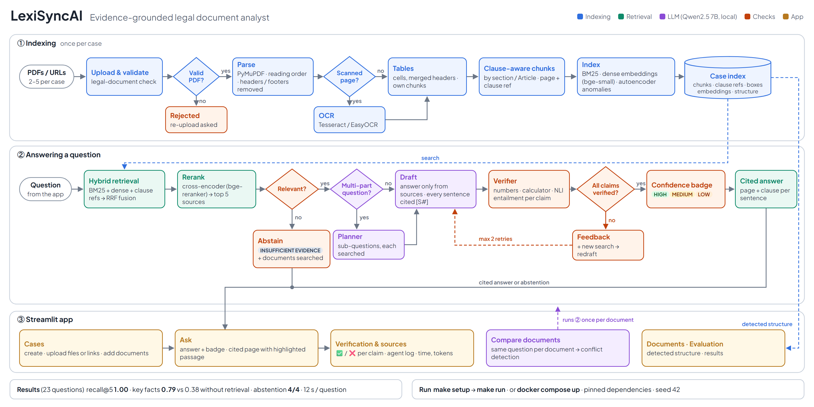

# LexiSyncAI: Evidence-Grounded Legal Document Analyst

LexiSyncAI answers questions about public legal documents (contracts, statutes, regulatory filings) and backs every claim with the exact page and clause it comes from. When the documents do not contain the answer, it says so instead of guessing.

Final project for **DA3 Deep Learning & GenAI** (WiSe 2025/26). Everything runs locally with open models; no paid service is needed.

**Repository:** https://github.com/kaushik776/LexiSyncAI



*One-page architecture diagram: [docs/architecture.pdf](docs/architecture.pdf) (source: [docs/architecture.html](docs/architecture.html)).*

---

## Contents

1. [What it does](#what-it-does)
2. [Quick start](#quick-start)
3. [How it works](#how-it-works)
4. [Results](#results)
5. [Extended features](#extended-features)
6. [Project structure](#project-structure)
7. [Configuration](#configuration)
8. [Limitations](#limitations)

---

## What it does

1. **Create a case.** Upload 2–5 public legal PDFs, or paste links to them.
2. **Indexing.** The system reads the documents and shows their structure: pages, sections, tables, scanned pages (read with OCR) and unusual pages.
3. **Ask a question**, for example *"Under the GDPR, what is the maximum fine, and which violations trigger the higher fine?"*
4. **Get a cited answer.** Each sentence carries a citation `[S1]` to a document, page and clause (e.g. *GDPR, p. 82, Article 83(5)*). The cited page is shown next to the answer with the passage highlighted.
5. **Check the confidence badge**: **HIGH / MEDIUM / LOW / INSUFFICIENT EVIDENCE**. Every claim is checked against its source, and the Verification tab shows the result of each check.
6. **Unanswerable questions.** The system abstains and lists the documents it searched.
7. **Compare documents.** The same question is asked of each document separately, and the answers are checked for conflicts (e.g. a liability cap of EUR 2.0M in one version and EUR 2.5M in the amended one).

Three example cases are included:

| Case | Documents | Shows |
|---|---|---|
| `default` | GDPR (EUR-Lex), UK Consumer Rights Act 2015 (legislation.gov.uk), Tax Protection Agreement (SEC EDGAR, EX-10.2) | Main evaluation: 23 questions |
| `conflict_demo` | Two versions of a supply agreement (fictional, made for the demo by `eval/make_conflict_samples.py`) | Conflict detection |
| `scanned_pdf` | The same SEC exhibit (EX-10.3, 20 pages) twice: an image-only scan and the digital original | OCR, and scanned vs digital |

Document sources:
- GDPR: https://eur-lex.europa.eu/legal-content/EN/TXT/PDF/?uri=CELEX:32016R0679
- UK Consumer Rights Act 2015: https://www.legislation.gov.uk/ukpga/2015/15/pdfs/ukpga_20150015_en.pdf
- EX-10.2: https://www.sec.gov/Archives/edgar/data/1651721/000095017025016688/gipr-ex10_2.htm
- EX-10.3: https://www.sec.gov/Archives/edgar/data/1862463/000164117225008369/ex10-3.htm

---

## Quick start

### Option A: Makefile (one command)

Requirements:
- Python 3.12;
- [Ollama](https://ollama.com);
- `make` (on Windows, use Git Bash with make installed, e.g. `choco install make`);
- optionally an NVIDIA GPU. CPU works but is slower.

```bash
make setup     # creates .venv, installs the pinned packages, downloads qwen2.5:7b, builds the example cases
make run       # starts the app at http://localhost:8501
```

All targets (`make` lists them):

| Command | What it does |
|---|---|
| `make setup` | First run: `install` + `model` + `index` |
| `make install` | Creates `.venv` and installs `requirements.txt` (124 pinned packages; CUDA 12.4 build of PyTorch) |
| `make model` | `ollama pull qwen2.5:7b` |
| `make index` | Builds the example cases `default`, `conflict_demo`, `scanned_pdf` |
| `make run` | Starts the Streamlit app |
| `make test` | Runs the 58 automated tests |
| `make eval-quick` | Evaluations without the LLM: retrieval recall@k, tables, autoencoder (~2 min) |
| `make eval` | All evaluations, incl. answers, ablations, regions, OCR, scanned vs original, latency (~30 min; needs Ollama) |
| `make docker-up` / `make docker-gpu` | Runs everything in Docker (see below) |
| `make docker-logs` / `make docker-down` | Follows the logs / stops the containers |

### Option B: Docker (no Python or Ollama needed)

```bash
docker compose up --build -d                                                   # CPU
docker compose -f docker-compose.yml -f docker-compose.gpu.yml up --build -d   # NVIDIA GPU
```

Then open http://localhost:8501.

- **Containers:** two are started, the app (`python:3.12-slim` + Tesseract) and Ollama (`ollama/ollama:0.40.16`).
- **First start:** downloads the LLM and the Hugging Face models and builds the example cases, which takes several minutes. Follow it with `make docker-logs`.
- **Later starts:** take seconds, because models and cases are kept in Docker volumes.

### Reproducibility

- **Dependencies:** pinned to exact versions in `requirements.txt`; the Docker images are pinned too.
- **Fixed seeds:** `SEED = 42` (LLM sampling and autoencoder training). LLM temperature 0.
- **Offline use:** once the models are downloaded, the app runs offline (Hugging Face offline mode is switched on automatically when the models are cached).

---

## How it works

The architecture diagram above shows every step. In short:

### 1. Indexing (once per case): `src/ingest.py`, `src/chunker.py`, `src/indexer.py`

| Step | Detail |
|---|---|
| Validate | Empty, non-PDF, damaged, password-protected or text-less files are rejected with a request to re-upload. URLs are downloaded with a 60 MB cap and a PDF signature check. A keyword score warns (but still indexes) when a file does not look like a legal document. |
| Parse | PyMuPDF text blocks with bounding boxes and fonts. Two-column reading order. Running headers and footers removed (text repeated in the top 13 % / bottom 8 % of ≥ 3 pages). Footnotes and table-of-contents blocks marked. |
| Scanned pages | A page with < 25 characters whose images cover ≥ 30 % of it is flagged as scanned and read with OCR: Tesseract (300 dpi) if installed, otherwise EasyOCR (200 dpi, GPU). |
| Tables | `find_tables` plus words assigned to cells. Merged cells and spanning headers are kept. Each table becomes its own chunk in Markdown with cell boxes. |
| Clause-aware chunking | The mode is chosen per document: *sections* (contracts), *regulations* (Articles, e.g. GDPR), *paragraphs* (fallback). Headings become clause references ("Article 83(4)-(5)", "Section 7.2"). Chunks split at paragraph boundaries (target 220, max 350, min 40 words) and keep page range, heading path and boxes. |
| Index | BM25 with a tokenizer that keeps clause numbers ("7.2", "83(4)") as tokens. Dense embeddings with `BAAI/bge-small-en-v1.5` (384-d). Autoencoder page-anomaly detector. |

### 2. Answering a question: `src/pipeline.py`

1. **Hybrid retrieval** (`retriever.py`): BM25 top 40 + dense top 40 + a clause-reference lookup (a question naming "Article 33" boosts that clause), fused with Reciprocal Rank Fusion (k = 60).
2. **Cross-encoder reranking** (`reranker.py`): `BAAI/bge-reranker-v2-m3` scores each (question, passage) pair; the top 5 become the sources `[S1]`…`[S5]`.
3. **Early abstention**: if even the best passage scores below 0.05, the system stops without calling the LLM.
4. **Planner** (`planner.py`): multi-part and comparison questions are split into 2–3 sub-questions. Each is retrieved separately, which gives multi-hop evidence from different pages.
5. **Draft** (`generator.py`):
   - Qwen2.5 7B (Ollama, temperature 0) answers only from the numbered sources.
   - The output must follow a JSON schema: a list of sentences, each with the source numbers it relies on, plus an explanation, a conflict note and what is missing.
6. **Verifier** (`verifier.py`, `calculator.py`), for every claim:
   - every number must appear in its cited source;
   - comparisons ("exceeds", "longer than") are recomputed by a calculator;
   - an NLI model (`cross-encoder/nli-deberta-v3-base`) must find the claim entailed by the cited text;
   - wrong citations are moved to the source that does support the claim.
7. **Agent loop**: if a claim is rejected, the verifier's feedback and a new search for the missing information go back to the LLM for a redraft. At most 2 retries; the best draft is kept. Each step is shown in the Agent log tab.
8. **Coverage check**: for multi-part questions every part must be answered by a verified sentence; a missing part is answered and verified separately.
9. **Confidence badge** (`abstain.py`):

   | Badge | When |
   |---|---|
   | HIGH | Evidence relevance ≥ 0.7, every claim verified, nothing missing |
   | MEDIUM | Relevance ≥ 0.3 and ≥ 75 % of claims verified |
   | LOW | Weaker evidence |
   | INSUFFICIENT EVIDENCE | No relevant passage, the LLM finds the sources do not answer it, or no claim could be verified. The answer lists the documents searched. |

### 3. Comparing documents: `src/compare.py`

The question is answered for each document separately. Different figures for the same term, or an NLI contradiction between the answers, are reported as a **conflict**. Otherwise the verdict is *agree*, *only one document answers* or *none*. Each document's answer has its own Verification, Sources and cited-page view.

---

## Results

All numbers below come from the scripts in `eval/`. The raw outputs are in `eval/results/`, and the app shows them in its Evaluation tab.

The main question set has **23 held-out questions** on the `default` case (`eval/questions.json`):
- 13 factual;
- 6 multi-hop across two pages or documents;
- 4 unanswerable.

Gold pages are found automatically from an evidence phrase per question (`eval/build_questions.py`).

### Retrieval: recall@k per configuration (`eval/retrieval_eval.py`)

| Configuration | R@1 | R@3 | R@5 | R@10 | MRR | ms/query |
|---|---|---|---|---|---|---|
| BM25 only | 0.658 | 0.868 | 0.974 | 1.000 | 0.860 | 3 |
| Dense only | 0.605 | 0.868 | 0.895 | 0.974 | 0.815 | 24 |
| Hybrid (BM25 + dense, RRF) | 0.605 | 0.842 | 0.921 | 1.000 | 0.825 | 25 |
| Hybrid + clause-reference lookup | 0.684 | 0.763 | 0.842 | 1.000 | 0.815 | 27 |
| Dense + cross-encoder rerank | 0.868 | 0.921 | 1.000 | 1.000 | 1.000 | 511 |
| Hybrid + cross-encoder rerank | 0.868 | 0.921 | 1.000 | 1.000 | 1.000 | 516 |
| **Hybrid + refs + rerank (final)** | **0.868** | **0.921** | **1.000** | **1.000** | **1.000** | 519 |

On these clean digital documents the reranker is what matters most; BM25 alone already beats dense retrieval because legal questions name exact terms and clause numbers. On OCR text (scanned case below) dense retrieval drops much further, and the hybrid + rerank setup is what keeps recall up.

### Answers (`eval/answer_eval.py`)

Mandatory comparison (no retrieval vs retrieval, dense-only vs hybrid) and ablations:

| Configuration | Key facts | Key facts (multi-hop) | Citation precision | Evidence recall | Abstention (unanswerable) | False abstention | Mean s |
|---|---|---|---|---|---|---|---|
| **full system** | **0.789** | 0.667 | 0.699 | 0.868 | **4/4** | 0.105 | 12.1 |
| no retrieval (LLM alone) | 0.377 | 0.444 | – | 0 | 0/4 | 0 | 4.3 |
| dense only (no BM25) | 0.789 | 0.667 | 0.681 | 0.868 | 4/4 | 0.105 | 12.2 |
| no verifier | 0.798 | 0.694 | 0.789 | 1.000 | 4/4 | 0 | 7.9 |
| text only (no tables) | 0.693 | 0.528 | 0.680 | 0.737 | 4/4 | 0.158 | 11.8 |

**Manual correctness (full system)**, graded by hand: 1 = correct, 0.5 = partly correct, 0 = wrong. The grades and a note for each answer are in `eval/results/answers_for_grading.csv`.

| Questions | Correct |
|---|---|
| Factual (13) | 11 / 13 = **0.846** |
| Multi-hop (6) | 4 / 6 = **0.667** |
| **All answerable (19)** | **15 / 19 = 0.789** |
| Unanswerable, correctly abstained (4) | **4 / 4** |

Where points were lost:
- **False abstentions:** two answers that are in the documents (F11, M03) were refused.
- **Incomplete answers:** three answers miss part of the expected detail (F09, M01, M04).
- **Too brief:** one answer is correct but very short (F12).

How to read it:
- **Retrieval doubles accuracy.** Key facts 0.789 vs 0.377 without retrieval; without the documents the LLM also never abstains.
- **Hybrid vs dense only:** the same key facts, but slightly higher citation precision.
- **Tables matter.** Without table chunks, accuracy and evidence recall drop and false abstentions rise.
- **The verifier trades a little recall for safety.** It rejects claims it cannot confirm, which costs a few correct answers on this set (false abstention 10.5 %); in return a HIGH badge always means every claim was checked against its cited text.

Metric definitions:
- *Key facts:* an automatic stand-in for correctness, the share of expected figures and terms present in the answer.
- *Manual correctness:* graded by hand, see the table above.
- *Citation precision:* share of cited sources whose page holds gold evidence.
- *Evidence recall:* share of gold evidence covered by the citations.

### Scanned document vs digital original (`eval/scanned_eval.py`, `eval/ocr_eval.py`)

The `scanned_pdf` case holds the same 20-page SEC exhibit as an image-only scan and as the digital original. 25 questions (16 factual, 5 multi-hop, 4 unanswerable, `eval/scanned_questions.json`) are asked of each copy separately. The gold pages are identical, so any difference is the effect of OCR.

| | Original (digital) | Scanned (OCR) |
|---|---|---|
| Retrieval R@5 / MRR, final system | 0.929 / 0.929 | 0.929 / 0.910 |
| Retrieval R@5, dense only | 0.905 | **0.762** |
| Answers: key facts | 0.770 | 0.857 |
| Answers: citation precision | 0.858 | 0.860 |
| Abstention on unanswerable | 4/4 | 4/4 |

OCR accuracy against the original text:

| Measure | Result |
|---|---|
| Pages detected as scanned | 20/20 |
| Character accuracy | 86.3 % |
| Word accuracy | 78.0 % (worst page 41 %: the two-column signature page) |
| Time per page | 8.8 s (EasyOCR) |

What this shows:
- **Hybrid search + reranking keeps retrieval at the level of the digital original.** Dense search alone loses a lot on OCR text.
- **Answer quality shows no measurable loss.** The small differences between the copies are within run-to-run variation on 21 questions.
- **Known risk:** OCR read "$1.25" as "Sl.25", and the answer repeated it with a correct citation. Citations stay right, but a misread figure can pass into the answer.

### Other evaluations

| Evaluation | Result | Script |
|---|---|---|
| Table extraction vs manual ground truth | 4/4 tables detected, cell accuracy **98.1 %**, all shapes correct | `eval/table_eval.py` |
| Citation precision at region level (highlight box covers the gold text) | **0.511** (page level 0.6); highlight covers 18 % of the page on average | `eval/region_eval.py` |
| Autoencoder page-anomaly detector | 21 of 265 pages flagged: contents pages, tables, cover, signature and nearly empty pages. Precision 0.333 against automatic labels; 0.667 when also counting pages labelled by hand after the first run | `eval/anomaly_eval.py` |
| Latency | 12.1 s per question on average (factual 10.1 s, multi-hop 22.3 s, unanswerable 3.2 s); 89 % of the time is the LLM | `eval/latency_report.py` |
| Optimisations measured | Reranker fp32 → fp16: 1.49 s → 0.45 s (3.3×, same top 5). NLI fp32 → bf16: 2.6× faster, same labels | `eval/latency_report.py` |
| Cost | 0 (local). 85,883 input + 5,237 output tokens for the 23 questions | `eval/latency_report.py` |
| LLM choice | Qwen2.5 7B vs Qwen3 8B: same quality on the sample; Qwen3 2.4× slower (10× with thinking on) | `eval/model_compare.py` |

Hardware for all timings: laptop with an NVIDIA RTX 4060 (8 GB), 16 GB RAM, on mains power. On battery the GPU is throttled about 3×.

---

## Extended features

Status of each optional feature from §4 of the brief:

| # | Feature | Status | Where it is shown |
|---|---|---|---|
| 1 | OCR for scanned pages | ✅ | Detection plus Tesseract → EasyOCR fallback. On a real 20-page scan: 20/20 pages detected, 86 % character accuracy, retrieval as good as on the digital original (`scanned_pdf` case) |
| 2 | Table extraction | ✅ | Merged cells and spanning headers; 98.1 % cell accuracy vs manual ground truth |
| 3 | Chart/figure reading with a VLM | ❌ | Not implemented |
| 4 | Bounding-box citations on the page image | ✅ | Cited passage highlighted on the page; region-level citation precision 0.511 |
| 5 | Planner + verifier agent loop | ✅ | Agent log tab: plan → draft → verify → re-retrieve → redraft (max 2 retries, best draft kept) |
| 6 | Fine-tuned reranker/embedder | ❌ | Not implemented (off-the-shelf models) |
| 7 | Ablation table | ✅ (partly) | Text-only vs + tables, with / without verifier (no figures, see #3) |
| 8 | Autoencoder component | ✅ | Page-anomaly detector (12 → 8 → 2 → 8 → 12), shown per document with its reason |
| 9 | Multi-document cross-referencing | ✅ | Compare documents: answers reconciled, conflicts detected (`conflict_demo`) |
| 10 | Public deployment | ❌ | Not deployed. The app supports an OpenAI-compatible API (`LLM_BACKEND=openai`) for hosting without a GPU |
| 11 | Latency and cost report | ✅ | Seconds and tokens per question and per stage; two optimisations measured |

Additional features beyond the list:
- URL import;
- invalid-PDF handling with re-upload messages;
- legal-document check;
- adding documents to an existing case;
- calculator check for comparison claims;
- Docker with optional GPU;
- offline mode.

---

## Project structure

```
app.py                     Streamlit app: cases, Ask (whole case / compare documents), Documents, Evaluation
src/
  config.py                all settings (each can be overridden by an environment variable)
  ingest.py                PDF parsing, reading order, headers/footers, tables, scanned pages + OCR
  chunker.py               clause-aware chunking, clause references
  indexer.py               builds and loads a case (BM25 + embeddings + manifest), add documents
  retriever.py             hybrid retrieval: BM25 + dense + clause refs, RRF, document filter
  reranker.py              cross-encoder reranker
  planner.py               sub-questions for multi-part questions
  generator.py             LLM prompt and JSON schema, cited draft
  verifier.py              number check, NLI entailment, citation correction
  calculator.py            recomputes comparisons between quantities
  pipeline.py              the full question-answering loop
  abstain.py               confidence badge and abstention
  compare.py               multi-document comparison and conflict detection
  anomaly.py               autoencoder page-anomaly detector
  llm.py                   Ollama / OpenAI-compatible client
  fetch.py                 safe PDF download from URLs
  legal_check.py           "is this a legal document?" check
  offline.py               Hugging Face offline mode when models are cached
eval/                      evaluation scripts, question sets, ground truth; results in eval/results/
tests/                     58 pytest tests
data/                      example documents (data/scanned/ = scanned_pdf case)
samples/conflict/          the two fictional contract versions for conflict_demo
docs/                      architecture diagram (PNG, PDF, HTML source)
Makefile, Dockerfile, docker-compose*.yml, docker/entrypoint.sh
```

Code quality: the code is modular (one responsibility per module) and every setting lives in `src/config.py`. Tests cover:
- ingestion and chunking;
- retrieval;
- generation parsing and the verifier;
- the calculator;
- URL fetching;
- invalid PDFs;
- the legal check;
- the autoencoder and comparison;
- adding documents to a case.

---

## Configuration

Every value in [src/config.py](src/config.py) can be overridden with an environment variable of the same name. The most useful ones:

| Setting | Default | Meaning |
|---|---|---|
| `LLM_BACKEND` | `ollama` | `openai` = any OpenAI-compatible API (set `OPENAI_API_KEY`; default base URL is Groq) |
| `LLM_MODEL` | `qwen2.5:7b` | Ollama model |
| `OLLAMA_HOST` | `http://localhost:11434` | Ollama server |
| `TOP_K` / `CANDIDATES` | 5 / 40 | Passages given to the LLM / taken from each retriever |
| `ABSTAIN_SCORE`, `LOW_SCORE`, `HIGH_SCORE` | 0.05, 0.3, 0.7 | Badge and abstention thresholds |
| `USE_PLANNER`, `USE_VERIFIER`, `MAX_RETRIES` | true, true, 2 | Agent loop |
| `USE_OCR` | true | OCR scanned pages |

---

## Limitations

- **OCR errors pass into answers.** A misread figure ("Sl.25" for "$1.25") is cited correctly but not corrected. The verifier checks the answer against the OCR text, not against the image.
- **The verifier is strict.** About 10 % of answerable questions end in abstention because a correct claim could not be confirmed by the NLI model (e.g. paraphrased legal wording).
- **Small evaluation sets.** 23 + 25 questions; differences of one or two questions are within run-to-run variation. Key-fact recall is an automatic stand-in; the manual grade (0.789 on answerable questions) is the reference.
- **Autoencoder labels.** Part of the anomaly evaluation uses pages labelled by hand after seeing the first results, so 0.667 is optimistic; 0.333 is the strict figure.
- **Speed.** About 12 s per question on a laptop GPU, mostly the 7B LLM; about 3× slower on battery, much slower on CPU only.
- **Not implemented:** reading charts and figures (VLM), a fine-tuned reranker or embedder, public deployment.

---

## License

MIT, see [LICENSE](LICENSE). The example documents are public legal texts from EUR-Lex, legislation.gov.uk and SEC EDGAR; the `conflict_demo` contracts are fictional.
